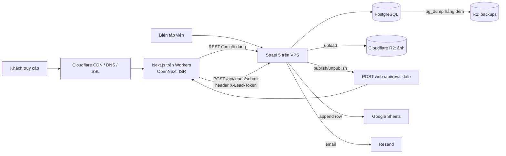

# Kiến trúc

## Tổng thể

## Quyết định chính

| # | Quyết định | Lý do |
| --- | --- | --- |
| D1 | **Strapi 5 là nguồn dữ liệu duy nhất**, kể cả lead | Lead lưu DB trước, Sheets chỉ là bản đồng bộ → không mất lead khi Sheets lỗi (FR-LEAD-04/05) |
| D2 | Next.js chạy trên **Cloudflare Workers qua `@opennextjs/cloudflare`** | Free tier, CDN toàn cầu, giảm tải cho VPS 2 GB |
| D3 | **Không build trên VPS.** CI build Docker image cho Strapi, đẩy lên GHCR, VPS chỉ `docker compose pull && up -d` | Build Strapi admin + Next cần > 2 GB RAM |
| D4 | Next.js gọi Strapi REST, cache bằng `fetch(..., { next: { tags } })`; Strapi bắn webhook revalidate theo tag khi publish | Trang tĩnh, cập nhật gần như tức thời (NFR-03) |
| D5 | Form gửi tới **route handler của Next** (honeypot, rate limit, validate), route này gọi Strapi với `X-Lead-Token` bí mật | Endpoint lead của Strapi không public; trình duyệt không thấy token |
| D6 | Google Sheets gọi **REST trực tiếp bằng service account JWT** (ký RS256 với `node:crypto`), không dùng `googleapis` | Giảm dependency nặng; logic ~60 dòng, dễ test |
| D7 | Email qua **Resend REST API** bằng `fetch`; thiếu `RESEND_API_KEY` thì chỉ log | Không phụ thuộc SMTP; dev chạy được không cần key |
| D8 | **Redirect không dùng middleware.** Catch-all route `app/[...legacy]` + nhánh notFound của trang chi tiết tra bảng Redirect rồi `permanentRedirect()` | Tránh gọi Strapi ở mọi request; vẫn quản lý được trong CMS (FR-CMS-07) |
| D9 | i18n Strapi **bật sẵn, một locale `vi`**; frontend chưa có route locale | GĐ2 song ngữ chỉ cần thêm locale + route `[locale]`. Chấp nhận: Strapi chỉ cho localize cả component, nên giá/phí trong `cruise.options`, `tour.itinerary`, `tour.cancellationRules` được nhập riêng theo locale; GĐ2 thêm document middleware chép giá/phí từ `vi` sang locale khác khi lưu |
| D10 | Retry Sheets: 3 lần ngay (backoff 1s/3s/9s) + **cron 10 phút** quét lead `failed`/`pending` quá 5 phút | Tự phục hồi khi Sheets lỗi tạm thời |

## Hạ tầng

| Thành phần | Chạy ở | Ghi chú |
| --- | --- | --- |
| Strapi + PostgreSQL 16 | VPS Long Vân 1 core / 2 GB / 50 GB, Docker Compose | Swap 2 GB; Caddy làm reverse proxy + TLS cho `cms.<domain>` |
| Next.js | Cloudflare Workers | Deploy bằng `wrangler` trong GitHub Actions |
| Ảnh | R2 bucket `azway-media` (public qua custom domain `media.<domain>`) | Provider `@strapi/provider-upload-aws-s3` với endpoint R2 |
| Backup | R2 bucket `azway-backups` | `pg_dump` + gzip mỗi đêm, giữ 7 bản |
| Uptime | Cloudflare Health Check hoặc UptimeRobot free | NFR-11 |

**Mọi tài khoản đứng tên AZway** (Cloudflare, VPS, Google, Resend, GitHub org). Dev có thể dùng tài khoản cá nhân, nhưng resource production tạo trong tài khoản AZway.

## Biến môi trường

### `apps/cms/.env`

| Biến | Bắt buộc | Mô tả |
| --- | --- | --- |
| `HOST`, `PORT` | | Mặc định `0.0.0.0`, `1337` |
| `APP_KEYS`, `API_TOKEN_SALT`, `ADMIN_JWT_SECRET`, `TRANSFER_TOKEN_SALT`, `JWT_SECRET`, `ENCRYPTION_KEY` | ✓ | Secrets Strapi |
| `PUBLIC_URL` | ✓ prod | `https://cms.<domain>` |
| `ADMIN_PATH` | | Đường dẫn admin (NFR-07), mặc định `/admin`. Đọc lúc `strapi build` → phải có khi build image |
| `DATABASE_CLIENT` | | `sqlite` (dev) / `postgres` (prod) |
| `DATABASE_URL` hoặc `DATABASE_HOST/PORT/NAME/USERNAME/PASSWORD` | ✓ prod | |
| `R2_ACCOUNT_ID`, `R2_ACCESS_KEY_ID`, `R2_SECRET_ACCESS_KEY`, `R2_BUCKET`, `R2_PUBLIC_URL` | prod | Thiếu → upload local |
| `LEAD_INGEST_TOKEN` | ✓ | Chuỗi bí mật dùng chung với web |
| `GOOGLE_SA_EMAIL`, `GOOGLE_SA_PRIVATE_KEY`, `GOOGLE_SHEET_ID`, `GOOGLE_SHEET_RANGE` | prod | Thiếu → lead vẫn lưu, trạng thái `skipped` |
| `RESEND_API_KEY`, `MAIL_FROM` | prod | Thiếu → log |
| `ALERT_EMAILS` | prod | Nhận cảnh báo Sheets lỗi |
| `WEB_REVALIDATE_URL`, `REVALIDATE_SECRET` | prod | `https://<domain>/api/revalidate` |
| `CORS_ORIGINS` | | Danh sách origin, phân tách dấu phẩy; trống → `http://localhost:3000` |

### `apps/web` (`.dev.vars` local, `wrangler secret` / vars trên Cloudflare)

| Biến | Mô tả |
| --- | --- |
| `NEXT_PUBLIC_SITE_URL` | `https://<domain>` |
| `CMS_URL` | `https://cms.<domain>` |
| `CMS_MEDIA_URL` | `https://media.<domain>` (allowlist cho ảnh) |
| `LEAD_INGEST_TOKEN` | Giống bên CMS |
| `REVALIDATE_SECRET` | Giống bên CMS |
| `NEXT_PUBLIC_GA_ID` | GA4 |

## Luồng lead chi tiết

1. Trình duyệt `POST /api/lead` (Next route handler) với form + `hp` (honeypot) + metadata (`sourcePage`, `landingPage`, UTM đọc từ cookie `az_utm` đặt ở lần vào đầu, `device`).
2. Route kiểm: honeypot rỗng; rate limit 5 req / 10 phút / IP (dùng Cloudflare Rate Limiting binding nếu có, fallback bộ nhớ trong isolate); validate SĐT `^0\d{9}$` (chuẩn hoá `+84`→`0`), email nếu có.
3. Route gọi Strapi `POST /api/leads/submit` kèm `X-Lead-Token`. Trả 201 ngay khi Strapi lưu xong.
4. Strapi: tạo lead `sheetsStatus=pending` → trả về → background: gửi email thông báo + đẩy Sheets (3 lần). Thành công → `synced`; thất bại → `failed`, ghi `sheetsError`, email `ALERT_EMAILS`.
5. Cron mỗi 10 phút đẩy lại lead `failed` hoặc `pending` cũ hơn 5 phút, tối đa 10 lần thử mỗi lead.

Cột Sheets cố định (thứ tự): `Thời điểm | Họ tên | SĐT | Email | Đơn vị | Ngày đi | Số người | Nhu cầu | Ghi chú | Loại SP | Mã SP | Tên SP | Trang nguồn | Trang vào | utm_source | utm_medium | utm_campaign | Thiết bị | ID`.
