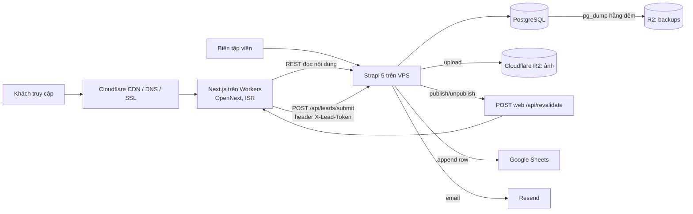

# Kiến trúc

## Tổng thể

## Quyết định chính

| # | Quyết định | Lý do |
| --- | --- | --- |
| D1 | **Strapi 5 là nguồn dữ liệu duy nhất**, kể cả lead | Lead lưu DB trước, Sheets chỉ là bản đồng bộ → không mất lead khi Sheets lỗi (FR-LEAD-04/05) |
| D2 | Next.js chạy trên **Cloudflare Workers qua `@opennextjs/cloudflare`** | Free tier, CDN toàn cầu, giảm tải cho VPS 2 GB |
| D3 | **Không build trên VPS.** CI build Docker image cho Strapi, đẩy lên GHCR, VPS chỉ `docker compose pull && up -d` | Build Strapi admin + Next cần > 2 GB RAM |
| D4 | Next.js gọi Strapi REST, cache bằng `fetch(..., { next: { tags } })`; Strapi bắn webhook revalidate theo tag khi publish. Webhook chỉ gửi `<type>` và `<type>:<slug>` của document đổi; **web** gắn cho mỗi fetch thêm `<type>` của mọi quan hệ nó populate hoặc lọc (bảng `RELATIONS` trong `apps/web/src/lib/cms.ts`) | Trang tĩnh, cập nhật gần như tức thời (NFR-03); đổi điểm đến làm mới cả trang tour hiện điểm đến đó. REST công khai (Public, không token) luôn trả bản đã xuất bản, bất kể `?status=` hay filter `publishedAt` nào; chỉ admin và API token đọc được nháp (`apps/cms/src/setup/published-only.ts`, test `tests/api.integration.test.ts`). Public không có quyền `upload` (`/api/upload/files?populate[related]` lộ nháp); populate ảnh trên các type nội dung không cần quyền đó |
| D5 | Form gửi tới **route handler của Next** (honeypot, rate limit, validate), route này gọi Strapi với `X-Lead-Token` bí mật | Endpoint lead của Strapi không public; trình duyệt không thấy token |
| D6 | Google Sheets gọi **REST trực tiếp bằng service account JWT** (ký RS256 với `node:crypto`), không dùng `googleapis` | Giảm dependency nặng; logic ~60 dòng, dễ test |
| D7 | Email qua **Resend REST API** bằng `fetch`; thiếu `RESEND_API_KEY` thì chỉ log | Không phụ thuộc SMTP; dev chạy được không cần key |
| D8 | **Redirect không dùng middleware.** Catch-all route `app/[...legacy]` (render theo request, không vào cache trang) + nhánh notFound của trang chi tiết và trang danh sách cẩm nang tra danh sách Redirect rồi `permanentRedirect()` (308) cho mục 301, `redirect()` (307) cho mục 302 | Tránh gọi Strapi ở mọi request; vẫn quản lý được trong CMS (FR-CMS-07). Mã 308/307 chứ không phải 301/302: App Router chỉ gửi được 308/307, còn middleware Node (`proxy.ts`) chưa chạy trên OpenNext Cloudflare. Google xử lý 308 như 301 (chuyển vĩnh viễn, giữ thứ hạng). `redirect.from` lưu dạng chuẩn: path đã percent-encode như `new URL(…).pathname` (vd `/tour-h%E1%BA%A1-long`, `/a%20b`), không host, không `?…#…`, không `/` cuối (`apps/cms/src/utils/redirect-path.ts`). Chuẩn hoá lại một giá trị đã lưu không đổi gì (`%25` giữ nguyên). Next đưa params đã decode từng đoạn, nên web so khớp theo một khoá chung cho cả hai bên: mỗi đoạn decode rồi `encodeURIComponent` (`apps/web/src/lib/redirect.ts`). Vì vậy `%3A` và `:` là một, còn `%2F` vẫn khác `/`. Test của web chạy trên bộ vector của CMS (`apps/cms/tests/redirect-paths.json`). Web lấy danh sách `GET /api/redirects` (Public đọc được) một lần, cache theo tag `redirect` và tra trong bộ nhớ: webhook xoá tag khi sửa redirect nên redirect mới có hiệu lực ngay, không cần build lại. CMS lỗi thì URL lạ trả 404 (render theo request, không cache) thay vì 500. Giới hạn đã biết: kiểm trùng và kiểm vòng lặp khi nhập CSV so theo dạng chuẩn của CMS, nên một cặp chỉ khác cách mã hoá ký tự dành riêng (`/old%3Apage` và `/old:page`) lọt qua thành hai dòng hoặc thành vòng lặp. Redirect nhập tay trong admin không được kiểm vòng lặp (ngoài GĐ1) |
| D9 | i18n Strapi **bật sẵn, một locale `vi`**; frontend chưa có route locale | GĐ2 song ngữ chỉ cần thêm locale + route `[locale]`. Chấp nhận: Strapi chỉ cho localize cả component, nên giá/phí trong `cruise.options`, `tour.itinerary`, `tour.cancellationRules` được nhập riêng theo locale; GĐ2 thêm document middleware chép giá/phí từ `vi` sang locale khác khi lưu |
| D10 | Retry Sheets: 3 lần ngay (backoff 1s/3s/9s) + **cron 10 phút** quét lead `failed`/`pending` quá 5 phút | Tự phục hồi khi Sheets lỗi tạm thời |
| D11 | **`/tour` lọc trên web**: một lần lấy cả catalog tour (cache tag `tour`, `destination`), lọc/sắp xếp/tìm/phân trang trong `lib/tour-filter.ts`; query string của khách không tới Strapi | Một cache cho mọi tổ hợp lọc, không đẩy truy vấn tuỳ ý lên VPS 1 core; tour "Liên hệ báo giá" xếp cuối khi sắp theo giá; tìm không dấu. Catalog tới vài trăm tour thì xem lại (lọc ở Strapi) |

## Hạ tầng

| Thành phần | Chạy ở | Ghi chú |
| --- | --- | --- |
| Strapi + PostgreSQL 16 | VPS Long Vân 1 core / 2 GB / 50 GB, Docker Compose | Swap 2 GB; Caddy làm reverse proxy + TLS cho `cms.<domain>` |
| Next.js | Cloudflare Workers | Deploy bằng `wrangler` trong GitHub Actions |
| Ảnh | R2 bucket `azway-media` (public qua custom domain `media.<domain>`) | Provider `@strapi/provider-upload-aws-s3` với endpoint R2 |
| Cache ISR của web | R2 bucket `azway-web-opennext-cache` + D1 `azway-web-tag-cache` | OpenNext: R2 giữ dữ liệu ISR, D1 giữ trạng thái `revalidateTag`. Tạo ở M8 |
| Tối ưu ảnh | Cloudflare Images (binding `IMAGES`) | `/_next/image` resize + AVIF/WebP trên Workers (NFR-02); không cần sharp |
| Backup | R2 bucket `azway-backups` | `pg_dump` + gzip mỗi đêm, giữ 7 bản |
| Uptime | Cloudflare Health Check hoặc UptimeRobot free | NFR-11 |

**Mọi tài khoản đứng tên AZway** (Cloudflare, VPS, Google, Resend, GitHub org). Dev có thể dùng tài khoản cá nhân, nhưng resource production tạo trong tài khoản AZway.

## Biến môi trường

### `apps/cms/.env`

| Biến | Bắt buộc | Mô tả |
| --- | --- | --- |
| `HOST`, `PORT` | | Mặc định `0.0.0.0`, `1337` |
| `APP_KEYS`, `API_TOKEN_SALT`, `ADMIN_JWT_SECRET`, `TRANSFER_TOKEN_SALT`, `JWT_SECRET`, `ENCRYPTION_KEY` | ✓ | Secrets Strapi |
| `PUBLIC_URL` | ✓ prod | `https://cms.<domain>` |
| `ADMIN_PATH` | | Đường dẫn admin (NFR-07), mặc định `/admin`. Đọc lúc `strapi build` → phải có khi build image (`apps/cms/Dockerfile` bắt buộc build arg này) |
| `SERVER_PROXY` | prod | `true` khi chạy sau proxy TLS (PaaS, Caddy): tin `X-Forwarded-*`, để cookie admin có `Secure` và rate limit đăng nhập admin đếm theo IP khách thay vì IP proxy |
| `DATABASE_CLIENT` | | `sqlite` (dev) / `postgres` (prod) |
| `DATABASE_URL` hoặc `DATABASE_HOST/PORT/NAME/USERNAME/PASSWORD` | ✓ prod | |
| `R2_ACCOUNT_ID`, `R2_ACCESS_KEY_ID`, `R2_SECRET_ACCESS_KEY`, `R2_BUCKET`, `R2_PUBLIC_URL` | prod | Thiếu → upload local |
| `LEAD_INGEST_TOKEN` | ✓ | Chuỗi bí mật dùng chung với web |
| `GOOGLE_SA_EMAIL`, `GOOGLE_SA_PRIVATE_KEY`, `GOOGLE_SHEET_ID`, `GOOGLE_SHEET_RANGE` | prod | Thiếu → lead vẫn lưu, trạng thái `skipped`. Key PEM một dòng, xuống dòng viết `\n`. Range mặc định `A:S` |
| `GOOGLE_TOKEN_URL`, `GOOGLE_SHEETS_API_URL`, `RESEND_API_URL` | | Chỉ để trỏ Google/Resend về server giả khi kiểm thử |
| `RESEND_API_KEY`, `MAIL_FROM` | prod | Thiếu → log |
| `ALERT_EMAILS` | prod | Nhận cảnh báo Sheets lỗi |
| `LEAD_NOTIFY_EMAILS` | | Nhận email lead mới khi `site-setting.leadNotifyEmails` trống |
| `CRON_ENABLED`, `LEAD_RETRY_CRON` | | Bật cron (mặc định `true`), lịch quét lại lead (mặc định `*/10 * * * *`) |
| `WEB_REVALIDATE_URL`, `REVALIDATE_SECRET` | prod | `https://<domain>/api/revalidate` |
| `CORS_ORIGINS` | | Danh sách origin, phân tách dấu phẩy; trống → `http://localhost:3000` |

### `apps/web` (`.dev.vars` cho `preview`, `.env.local` cho `dev`)

"Build" = phải có trong môi trường chạy `next build` (CI, deploy; local là `.env.local`, kể cả bước build của `preview`): giá trị được nhúng vào bundle. "Runtime" = đọc khi chạy trên Worker: biến không bí mật khai ở `vars` trong `wrangler.jsonc` với giá trị thật (M8; `wrangler deploy` ghi đè biến trên dashboard bằng `vars` và xoá biến không khai), bí mật qua `wrangler secret put`. Staging (`docs/STAGING.md`) không khai `vars`: `deploy-web.yml` truyền `CMS_URL` bằng `--var` và bí mật bằng `--secrets-file`.

| Biến | Khi nào | Mô tả |
| --- | --- | --- |
| `NEXT_PUBLIC_SITE_URL` | Build, bắt buộc | `https://<domain>`. Thiếu thì `next build` production dừng với lỗi |
| `CMS_URL` | Build + runtime (`vars`) | `https://cms.<domain>`. Lúc build: allowlist ảnh `/uploads/**`, và prerender các trang đọc CMS (ISR). Build production thiếu biến này thì lỗi, trừ khi đặt `BUILD_WITHOUT_CMS=1` (chỉ job `check` của CI): khi đó các trang đó chuyển sang render theo request (`renderPerRequestWithoutCms`, `src/lib/build.ts`) thay vì cache trang rỗng. Lúc chạy: gọi API |
| `CMS_MEDIA_URL` | Build | `https://media.<domain>` (R2). Allowlist ảnh và CSP `img-src` lúc build |
| `LEAD_INGEST_TOKEN` | Runtime, secret | Giống bên CMS |
| `REVALIDATE_SECRET` | Runtime, secret | Giống bên CMS |
| `SITE_NOINDEX` | Build | `1` chỉ cho staging (`deploy-web.yml`): `robots.txt` chặn mọi đường dẫn và mọi response có `X-Robots-Tag: noindex, nofollow` |
| `NEXT_PUBLIC_GA_ID` | Build | GA4 (`G-…`). Không đặt thì không tải GA (dev, CI). Việc cần làm khi go-live: TASKS M8 |

## Luồng lead chi tiết

1. Trình duyệt `POST /api/lead` (Next route handler) với form + `hp` (honeypot) + metadata (`sourcePage`, `landingPage`, UTM đọc từ cookie `az_utm` đặt ở lần vào đầu, `device`).
2. Route kiểm: honeypot rỗng; rate limit 5 req / 10 phút / IP, đếm trong bộ nhớ của isolate (`lib/rate-limit.ts`: chỉ chặn một client trên một isolate; binding Rate Limiting chỉ đếm theo 10/60 giây nên không dùng; giới hạn chặt là việc của M8); validate SĐT `^0\d{9}$` (chuẩn hoá `+84`→`0`), email nếu có.
3. Route gọi Strapi `POST /api/leads/submit` kèm `X-Lead-Token`. Trả 201 ngay khi Strapi lưu xong.
   - Body JSON phẳng: `fullName`, `phone` (bắt buộc); `email`, `organization`, `travelDate` (`YYYY-MM-DD`), `groupSize` (1–10000), `need`, `note`, `productType` (`tour|cruise|teambuilding`), `productCode`, `productName`, `sourcePage`, `landingPage`, `utm_source`, `utm_medium`, `utm_campaign`, `device`, `ipHash` (tuỳ chọn; giới hạn độ dài trong `apps/cms/src/services/lead-input.ts`: trường khách gõ quá dài → 400; `sourcePage`, `landingPage`, `utm_*`, `device`, `ipHash` là dữ liệu tracking, quá dài thì bị cắt, không làm mất lead).
   - Trả về: `201 {id}` · `400 {error:{details:{errors:{<trường>: <lý do>}}}}` · `401` thiếu/sai token (token < 32 ký tự cũng bị từ chối).
4. Strapi: tạo lead `sheetsStatus=pending` → trả về → background: gửi email thông báo (gửi được thì đánh dấu `notifiedAt`) + đẩy Sheets (thử 1 lần + 3 lần lặp lại). Thành công → `synced`; thất bại → `failed`, ghi `sheetsError`, email `ALERT_EMAILS` (không chứa dữ liệu cá nhân) ở lần lỗi đầu và khi bỏ cuộc.
5. Cron mỗi 10 phút đẩy lại lead `failed` hoặc `pending` cũ hơn 5 phút (tối đa 10 lượt Sheets, `sheetsAttempts`), và gửi lại email cho lead cũ hơn 5 phút chưa có `notifiedAt` (tối đa 10 lần gửi lỗi, đếm riêng ở `notifyAttempts`, chỉ lead tạo trong 24 giờ, quá 24 giờ chưa gửi được thì log warn một lần và đặt `notifyAttempts` = 10; thiếu `RESEND_API_KEY` chỉ log, không đếm, cron không gửi lại).

Mọi ô chữ do khách nhập được thêm `'` phía trước (`USER_ENTERED` sẽ chạy `=…` như công thức và đổi `09…` thành số). Cột Sheets cố định (thứ tự): `Thời điểm | Họ tên | SĐT | Email | Đơn vị | Ngày đi | Số người | Nhu cầu | Ghi chú | Loại SP | Mã SP | Tên SP | Trang nguồn | Trang vào | utm_source | utm_medium | utm_campaign | Thiết bị | ID`.

## Revalidate

Strapi gửi `POST WEB_REVALIDATE_URL`, header `x-revalidate-secret`, body `{ "tags": [...] }` (`apps/cms/src/setup/revalidate.ts`):

- Type có D&P: khi publish / unpublish / delete. Type không D&P (`redirect`, `site-setting`): khi create / update / delete. `lead` không bao giờ gửi.
- Tag = `<type>` và `<type>:<slug>` cho mọi slug của document trước và sau thao tác (đổi slug → xoá cache cả trang cũ). Single type chỉ có `<type>`. Không gửi tag phụ thuộc (xem D4). `<type>` là singularName, cùng khoá với `RELATIONS` của web: `tour`, `cruise`, `teambuilding`, `destination`, `article`, `article-category`, `feedback`, `site-setting`, `homepage`, `redirect`.
- Gửi sau khi transaction của thao tác commit (publish trong admin chạy trong transaction). Lỗi/timeout 5 s chỉ ghi log, không chặn thao tác.
