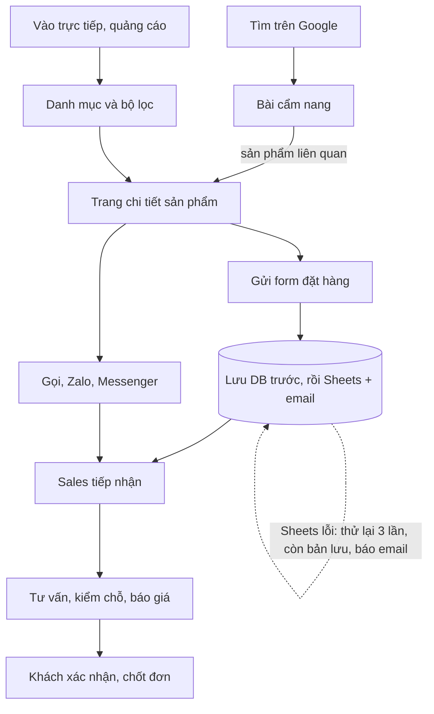

# AZway Website — BRD / PRD Giai đoạn 1

> Nguồn gốc: tài liệu BRD/PRD đã thống nhất (bản nháp, rev 14, 08/10/2026). File này là **nguồn sự thật** cho việc code. Khi spec và code mâu thuẫn, sửa code; khi spec sai, sửa file này trong cùng PR và ghi rõ trong mô tả PR.

## 1. Tổng quan

Giai đoạn 1 xây lại website AZway thành kênh nhận yêu cầu đặt tour có cấu trúc, bàn giao trong 25 ngày làm việc.

| Mục | Nội dung |
| --- | --- |
| Khách hàng | Công ty Cổ phần AZway Việt Nam |
| Bên thực hiện | Đỗ Thị Thu Phương |
| Căn cứ | Đề xuất GĐ1 v3.0, sơ đồ Scope Website, sơ đồ Pipeline khách hàng |
| Liên kết hợp đồng | Phụ lục 01 (phạm vi) và Phụ lục 03 (nghiệm thu) lấy từ tài liệu này |

**Bối cảnh.** AZway bán tour trong nước, Trung Quốc, quốc tế, du thuyền và Teambuilding. Phần lớn đơn đến từ khách tổ chức — trường học, lớp, doanh nghiệp — với giá theo đầu người, chính sách FOC và lịch trình chia theo mốc giờ.

**Hiện trạng.** Website cũ dựng trên theme WordPress có sẵn: sản phẩm trình bày như bài viết, không lọc được, không tách tour với du thuyền, yêu cầu của khách đến rời rạc qua điện thoại và Zalo. Thiết kế mới đã được duyệt.

## 2. Mục tiêu kinh doanh và chỉ số

| Mã | Mục tiêu | Chỉ số | Cách đo |
| --- | --- | --- | --- |
| BO-1 | Không thất thoát yêu cầu | Tỷ lệ yêu cầu ghi nhận / tổng yêu cầu gửi | Đối chiếu Sheets với bản lưu trong hệ thống |
| BO-2 | Biết sản phẩm nào ra đơn | % yêu cầu có mã sản phẩm và nguồn | Cột nguồn trong Sheets |
| BO-3 | Nhân viên tự cập nhật | Số tour đăng mới không cần hỗ trợ | Lịch sử chỉnh sửa |
| BO-4 | Giữ thứ hạng Google | Hiển thị/nhấp Search Console | So 28 ngày trước khi chuyển |
| BO-5 | Tải nhanh trên điện thoại | PageSpeed mobile | Trang chủ, trang chi tiết |
| BO-6 | Tăng khách từ nội dung | Yêu cầu có nguồn từ bài cẩm nang | Cột trang nguồn |

BO-1, BO-2, BO-5 là cam kết GĐ1 và nằm trong checklist nghiệm thu.

## 3. Người dùng

**Bên ngoài**

| Chân dung | Cần gì | Hệ quả thiết kế |
| --- | --- | --- |
| Đại diện trường, lớp (GVCN, ban phụ huynh) | Lịch trình theo giờ, bao gồm / không bao gồm, an toàn, giá theo đầu người | Trường "Tên đơn vị", "Số người" trong form; danh sách bao gồm hiện rõ |
| Doanh nghiệp (HR, công đoàn) | Teambuilding, gala dinner, gói kết hợp | Trang Teambuilding; form ghi quy mô đoàn |
| Khách lẻ, gia đình | Giá, ngày khởi hành, gọi nhanh | Nút gọi, Zalo nổi; giá hiện ngay |
| Người đọc cẩm nang từ Google | Kinh nghiệm điểm đến | Bài viết gắn sản phẩm liên quan |

**Nội bộ AZway**

| Vai trò | Quyền |
| --- | --- |
| Quản trị viên | Toàn quyền, cấu hình, chuyển hướng URL |
| Biên tập viên | Tạo, sửa, xuất bản nội dung; không quản lý tài khoản |
| Sales | Làm việc trên Google Sheets, không cần tài khoản CMS |

## 4. Phạm vi

| Module | Giai đoạn 1 | Để giai đoạn 2 |
| --- | --- | --- |
| Quản trị nội dung | Tour, du thuyền, Teambuilding, điểm đến, cẩm nang, feedback, chuyển hướng URL | Khách sạn, xe di chuyển, Company Trip |
| Giao diện | Toàn bộ trang theo thiết kế đã duyệt, đa thiết bị | Trang mới ngoài thiết kế |
| Tìm kiếm, bộ lọc | Lọc theo loại, khu vực, cửa khẩu, thời lượng, quy mô đoàn; tìm theo tên, mã | Tìm gõ sai, không dấu (Meilisearch) |
| Nhận yêu cầu | Form trang sản phẩm, liên hệ nhanh, Sheets, email | Form nhúng trong bài cẩm nang |
| SEO | Metadata, sitemap, schema, chuyển hướng URL cũ | SEO định kỳ |
| Ngôn ngữ | Tiếng Việt (i18n bật sẵn, 1 locale `vi`) | Song ngữ Việt – Anh |
| Nội dung | Nhập mẫu 10 sản phẩm, 5 bài viết | Nhập toàn bộ kho |

**Ngoài phạm vi:** đặt chỗ thời gian thực, thanh toán, CRM, app di động, sản xuất nội dung, quảng cáo.

## 5. Luồng nghiệp vụ

Gửi form chỉ là **ghi nhận yêu cầu**, không phải xác nhận đặt chỗ — màn hình xác nhận phải nói rõ.

## 6. Yêu cầu chức năng

Mức **Bắt buộc** là điều kiện nghiệm thu. Mức **Nên có** làm nếu còn thời gian.

### 6.1 CMS

| Mã | Yêu cầu | Mức |
| --- | --- | --- |
| FR-CMS-01 | Tạo, sửa, xoá tour, du thuyền, Teambuilding, điểm đến, bài viết qua form từng trường | Bắt buộc |
| FR-CMS-02 | Trạng thái Nháp / Xuất bản; nháp không hiện ngoài website | Bắt buộc |
| FR-CMS-03 | Lịch trình theo ngày, mỗi ngày nhiều mốc giờ + hoạt động, kéo thả sắp xếp | Bắt buộc |
| FR-CMS-04 | Bao gồm / Không bao gồm là hai danh sách riêng | Bắt buộc |
| FR-CMS-05 | Ảnh tự tạo kích thước; có alt text | Bắt buộc |
| FR-CMS-06 | Mỗi nội dung có tiêu đề SEO, mô tả SEO, ảnh chia sẻ | Bắt buộc |
| FR-CMS-07 | Quản trị viên thêm cặp URL cũ → mới, có hiệu lực không cần deploy lại | Bắt buộc |
| FR-CMS-08 | Phân quyền Quản trị viên / Biên tập viên | Bắt buộc |
| FR-CMS-09 | Xem trước nháp trên giao diện thật | Nên có |
| FR-CMS-10 | Cấu hình chung (hotline, Zalo, Messenger, địa chỉ, MXH) sửa trong CMS | Bắt buộc |

### 6.2 Trang sản phẩm

| Mã | Yêu cầu | Mức |
| --- | --- | --- |
| FR-PRD-01 | Thẻ sản phẩm: ảnh, tên, thời lượng, giá từ, nhãn loại | Bắt buộc |
| FR-PRD-02 | Chi tiết: gallery, điểm nổi bật, lịch trình theo mốc giờ, bao gồm / không bao gồm, hoàn huỷ, giá | Bắt buộc |
| FR-PRD-03 | Giá "từ X đ/khách"; giá 0 hoặc trống → "Liên hệ báo giá" | Bắt buộc |
| FR-PRD-04 | Hiện ghi chú FOC và quy mô đoàn nếu có | Bắt buộc |
| FR-PRD-05 | Trường trống → ẩn cả khối | Bắt buộc |
| FR-PRD-06 | Gợi ý tối đa 4 sản phẩm cùng điểm đến hoặc cùng loại | Bắt buộc |
| FR-PRD-07 | Gợi ý bài cẩm nang gắn với sản phẩm | Nên có |
| FR-PRD-08 | Du thuyền hiện các lựa chọn: vé du ngoạn, thuê nguyên tàu, ăn tối | Bắt buộc |

### 6.3 Tìm kiếm và bộ lọc

| Mã | Yêu cầu | Mức |
| --- | --- | --- |
| FR-SRC-01 | Lọc theo loại, khu vực, cửa khẩu, thời lượng, quy mô đoàn; kết hợp nhiều điều kiện | Bắt buộc |
| FR-SRC-02 | Sắp xếp theo giá tăng/giảm, thời lượng | Bắt buộc |
| FR-SRC-03 | Tìm theo tên hoặc mã | Bắt buộc |
| FR-SRC-04 | Bộ lọc lưu trên URL | Bắt buộc |
| FR-SRC-05 | Không có kết quả → gợi ý bỏ bớt điều kiện + nút gọi | Bắt buộc |

### 6.4 Nhận yêu cầu

| Mã | Yêu cầu | Mức |
| --- | --- | --- |
| FR-LEAD-01 | Form: họ tên\*, điện thoại\*, email, tên đơn vị, ngày đi, số người, nhu cầu, ghi chú | Bắt buộc |
| FR-LEAD-02 | Tự gắn mã và tên sản phẩm đang xem | Bắt buộc |
| FR-LEAD-03 | SĐT Việt Nam 10 số; email đúng định dạng nếu nhập | Bắt buộc |
| FR-LEAD-04 | Lưu đồng thời Sheets và DB | Bắt buộc |
| FR-LEAD-05 | Sheets lỗi → thử lại 3 lần, vẫn lỗi thì email cảnh báo; yêu cầu không mất | Bắt buộc |
| FR-LEAD-06 | Email thông báo khi có yêu cầu | Bắt buộc |
| FR-LEAD-07 | Ghi trang nguồn, trang vào đầu, UTM, thiết bị | Bắt buộc |
| FR-LEAD-08 | Chống spam: honeypot + giới hạn theo IP | Bắt buộc |
| FR-LEAD-09 | Màn hình xác nhận nêu thời gian phản hồi | Bắt buộc |
| FR-LEAD-10 | Thanh liên hệ nổi: gọi, Zalo, Messenger | Bắt buộc |
| FR-LEAD-11 | Form liên hệ chung trên trang Liên hệ | Bắt buộc |

### 6.5 Cẩm nang

| Mã | Yêu cầu | Mức |
| --- | --- | --- |
| FR-BLG-01 | Danh sách theo danh mục, phân trang | Bắt buộc |
| FR-BLG-02 | Trang bài: ảnh, tác giả, thời gian đọc, mục lục tự sinh | Bắt buộc |
| FR-BLG-03 | Khối "Sản phẩm liên quan" cuối bài, chọn tay | Bắt buộc |
| FR-BLG-04 | Bài liên quan cùng danh mục | Nên có |

### 6.6 Trang chung

| Mã | Yêu cầu | Mức |
| --- | --- | --- |
| FR-GEN-01 | Trang chủ, Teambuilding, điểm đến, liên hệ, 404, tìm kiếm theo thiết kế | Bắt buộc |
| FR-GEN-02 | Header, footer, menu điện thoại, hero carousel | Bắt buộc |
| FR-GEN-03 | Album feedback khách hàng | Bắt buộc |
| FR-GEN-04 | Breadcrumb trên danh mục, chi tiết, bài viết | Bắt buộc |

## 7. Mô hình dữ liệu

Tour là trung tâm. Lịch trình, bao gồm / không bao gồm và hoàn huỷ là khối có cấu trúc riêng — không gộp vào một ô văn bản.

### 7.1 Content-type

| Content-type | Trường | Quan hệ |
| --- | --- | --- |
| Tour | Tên, mã, slug, loại (trong nước / Trung Quốc / quốc tế / trải nghiệm học tập), điểm khởi hành, cửa khẩu, thời lượng (ngày, đêm), phương tiện, giá từ (đ/khách), ghi chú FOC, quy mô đoàn min–max, điểm nổi bật, lịch trình, bao gồm, không bao gồm, hoàn huỷ, gallery, ảnh đại diện, SEO | n–n Điểm đến · n–n Bài viết |
| Du thuyền | Tên tàu, slug, hạng, sức chứa, lựa chọn (lặp: tên, giá, mô tả), mô tả, gallery, bao gồm, không bao gồm, SEO | n–n Điểm đến |
| Teambuilding | Tên, slug, nhóm, quy mô, trò chơi (lặp: tên, cách chơi, ảnh), gói kèm, album, SEO | n–n Tour |
| Điểm đến | Tên, slug, khu vực, ảnh, mô tả, SEO | n–n Tour, Du thuyền |
| Bài viết | Tiêu đề, slug, danh mục, ảnh, tác giả, nội dung, thời gian đọc (tự tính), SEO | n–n Tour, Du thuyền |
| Feedback | Tên đoàn, đơn vị, ngày, mô tả, album | n–1 Tour |
| Chuyển hướng | URL cũ, URL mới, mã 301/302 | — |
| Yêu cầu khách | Họ tên, SĐT, email, đơn vị, ngày đi, số người, nhu cầu, ghi chú, sản phẩm, trang nguồn, UTM, thiết bị, trạng thái đẩy Sheets, thời điểm | n–1 sản phẩm |
| Cấu hình chung | Hotline, Zalo, Messenger, email nhận yêu cầu, địa chỉ, MXH, thời gian cam kết phản hồi | Single type |

### 7.2 Component

| Component | Trường | Dùng ở |
| --- | --- | --- |
| Ngày lịch trình | Ngày thứ, tiêu đề, bữa ăn (sáng/trưa/tối), danh sách mốc | Tour |
| Mốc giờ | Giờ (HH:mm), tiêu đề, mô tả, ghi chú (vd "AZway tài trợ") | Ngày lịch trình |
| Mục dịch vụ | Một dòng nội dung | Bao gồm, Không bao gồm |
| Hoàn huỷ | Từ mốc (số ngày trước khởi hành), phí %, ghi chú | Tour |
| SEO | Tiêu đề, mô tả, ảnh chia sẻ, canonical, noindex | Mọi content-type công khai |

i18n bật sẵn cho content-type công khai với 1 locale `vi`, để làm song ngữ ở GĐ2 không phải đổi cấu trúc.

## 8. Yêu cầu phi chức năng

| Mã | Nhóm | Yêu cầu |
| --- | --- | --- |
| NFR-01 | Hiệu năng | PageSpeed trang chủ và chi tiết: mobile ≥ 75, desktop ≥ 85, trên tên miền thật, không tính mã nhúng bên thứ ba |
| NFR-02 | Hiệu năng | Ảnh WebP/AVIF, lazy-load, đúng kích thước |
| NFR-03 | Hiệu năng | Trang công khai sinh tĩnh, làm mới khi nội dung đổi (ISR), qua CDN |
| NFR-04 | Tương thích | 1920, 1536, 1024, 768, 414, 375 px; thiết bị từ 2022; Chrome, Safari, Edge mới nhất |
| NFR-05 | Khả dụng | Admin dùng trên máy tính; trang công khai dùng trọn trên điện thoại |
| NFR-06 | Bảo mật | HTTPS toàn site |
| NFR-07 | Bảo mật | Admin sau đường dẫn riêng, giới hạn đăng nhập sai, mật khẩu ≥ 12 ký tự |
| NFR-08 | Bảo mật | CSP, X-Frame-Options, X-Content-Type-Options |
| NFR-09 | Dữ liệu | Sao lưu DB hằng ngày, giữ 7 bản, ngoài máy chủ; thử khôi phục trước bàn giao |
| NFR-10 | Dữ liệu | Dữ liệu khách chỉ lưu trong hệ thống AZway sở hữu và Sheets của AZway |
| NFR-11 | Vận hành | Cảnh báo email khi site không phản hồi quá 5 phút |
| NFR-12 | Bảo trì | README triển khai, biến môi trường, sao lưu và khôi phục |

## 9. SEO và đo lường

| Mã | Yêu cầu |
| --- | --- |
| SEO-01 | URL: `/tour/<slug>`, `/du-thuyen/<slug>`, `/cam-nang/<slug>`, `/diem-den/<slug>`, `/teambuilding/<slug>` |
| SEO-02 | Title, description, canonical riêng mỗi trang; mặc định sinh từ nội dung nếu bỏ trống |
| SEO-03 | sitemap.xml, robots.txt tự cập nhật |
| SEO-04 | Schema: Organization/TravelAgency, BreadcrumbList, Article, TouristTrip |
| SEO-05 | Open Graph đúng từng trang (Facebook, Zalo) |
| SEO-06 | Trang có tham số lọc → canonical về trang danh mục gốc |
| SEO-07 | 301 toàn bộ URL cũ theo danh sách AZway giao |
| SEO-08 | 404 có ô tìm kiếm + sản phẩm nổi bật |
| AN-01 | GA4 + Search Console |
| AN-02 | Sự kiện `lead_submit` kèm mã sản phẩm, trang nguồn |
| AN-03 | Sự kiện `click_call`, `click_zalo`, `click_messenger` |
| AN-04 | Sự kiện `filter_apply` kèm điều kiện |
| AN-05 | Cột nguồn + UTM trong Sheets |

## 10. Kiến trúc và hạ tầng

Xem [ARCHITECTURE.md](./ARCHITECTURE.md).

## 11. Tiêu chí nghiệm thu

| # | Tiêu chí | Truy vết |
| --- | --- | --- |
| AC-01 | Trang hiển thị đúng thiết kế ở 6 độ phân giải | FR-GEN-01, NFR-04 |
| AC-02 | Menu mobile, carousel, popup, gallery chạy trên 3 trình duyệt | FR-GEN-02, FR-PRD-02 |
| AC-03 | Thanh liên hệ mở đúng gọi, Zalo, Messenger | FR-LEAD-10 |
| AC-04 | Biên tập viên tự tạo 1 tour đủ lịch trình, không cần hỗ trợ | FR-CMS-01/03/04 |
| AC-05 | Nháp không hiện ngoài website | FR-CMS-02 |
| AC-06 | Ảnh tự sinh kích thước | FR-CMS-05 |
| AC-07 | Lọc đúng với tổ hợp điều kiện | FR-SRC-01 |
| AC-08 | Tìm theo tên và mã đúng | FR-SRC-03 |
| AC-09 | Trường trống được ẩn | FR-PRD-05 |
| AC-10 | Yêu cầu vào Sheets trong 1 phút | FR-LEAD-04 |
| AC-11 | Sheets mất kết nối vẫn lưu, có email cảnh báo | FR-LEAD-05 |
| AC-12 | Email thông báo đúng địa chỉ | FR-LEAD-06 |
| AC-13 | Yêu cầu có mã sản phẩm và nguồn | FR-LEAD-02/07 |
| AC-14 | Mỗi trang có title, description riêng | SEO-02 |
| AC-15 | Sitemap chứa trang đã xuất bản | SEO-03 |
| AC-16 | URL cũ chuyển đúng | SEO-07, FR-CMS-07 |
| AC-17 | Chia sẻ Facebook, Zalo đúng ảnh, tiêu đề | SEO-05 |
| AC-18 | PageSpeed mobile ≥ 75, desktop ≥ 85 | NFR-01 |
| AC-19 | Bàn giao mã nguồn, tài khoản, tài liệu | NFR-12 |
| AC-20 | Đào tạo xong, có ghi hình | — |

## 12. Giả định và rủi ro

- Thiết kế đã duyệt, không đổi cấu trúc trang.
- AZway giao nội dung, ảnh, danh sách URL cũ trong 10 ngày kể từ ngày ký.
- Mọi tài khoản hạ tầng (Cloudflare, VPS, Google) đứng tên AZway.

| Rủi ro | Xử lý |
| --- | --- |
| Nội dung giao chậm | Dựng bằng dữ liệu mẫu (seed) |
| Mất thứ hạng khi chuyển | 301 đủ trước khi trỏ tên miền |
| Sheets mất kết nối | DB là nguồn chính, Sheets là bản đồng bộ, retry + cảnh báo |
| Mã nhúng làm chậm trang | Tải trễ widget chat |
| VPS 2 GB thiếu RAM | Không build trên VPS; frontend ở Cloudflare |

## 13. Câu hỏi mở (chưa chốt — dùng giá trị mặc định, để cấu hình được)

| Câu hỏi | Mặc định trong code |
| --- | --- |
| Tách danh mục "Trải nghiệm học tập"? | Có, là một giá trị của `tour.category` |
| Thời gian cam kết phản hồi | Trường `responseTimeText` trong Cấu hình chung |
| Email nhận thông báo | Trường `leadNotifyEmails` (danh sách, phân tách dấu phẩy) |
| Hiện giá hay "Liên hệ" | Theo FR-PRD-03: có giá thì hiện, trống thì "Liên hệ báo giá" |
| Danh sách URL cũ | Content-type Redirect; script import CSV |
